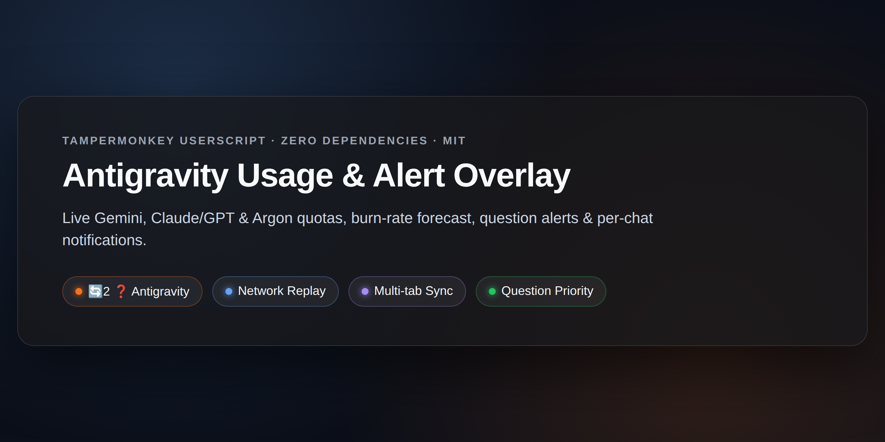
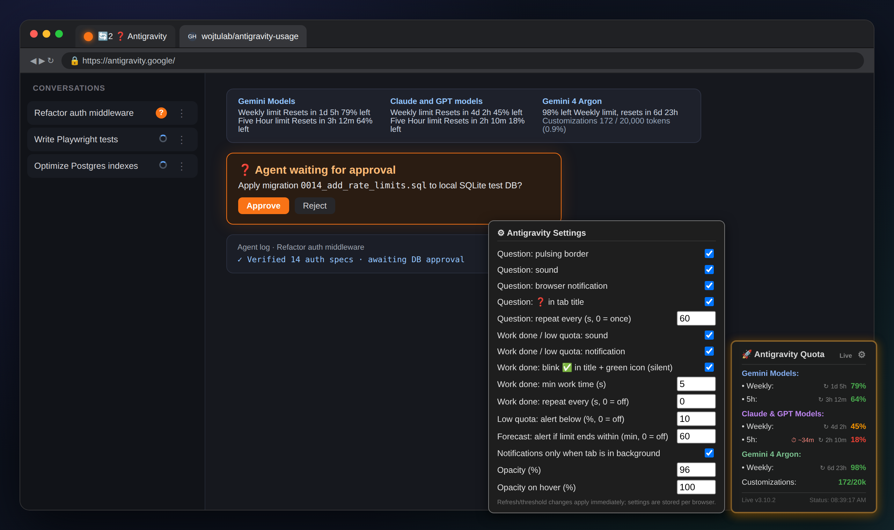
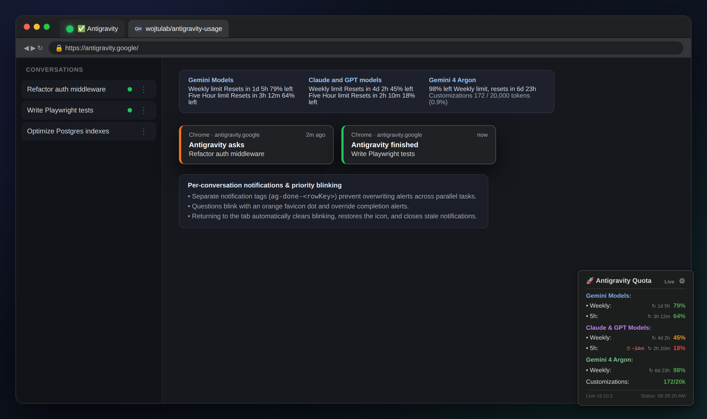

  

<h1 align="center">Antigravity Usage &amp; Alert Overlay</h1>

  
  
  
  

A lightweight, zero-dependency Tampermonkey / Violentmonkey userscript for **Google Antigravity**. Tracks **Gemini Models**, **Claude & GPT Models**, **Gemini 4 Argon**, and **Customizations** token budgets, estimates burn-rate exhaustion ETA, and alerts you with blinking tab titles, colored favicons, sounds, and notifications whenever an agent asks a question or finishes a task.

---

## Screenshots

### Question Priority Alert (Orange Favicon, Pulsing Border) & Settings (`⚙`)

### Per-Conversation Notifications, Green Favicon & Low-Quota Forecast

---

## Key Features

- **All Model Quotas, Live Countdowns & Customizations Budget**
  - Tracks Weekly & 5h limits for **Gemini Models**, **Claude & GPT Models**, **Gemini 4 Argon**, plus your **Settings → Customizations** token budget (`172/20k`), selecting the lowest remaining quota when multiple models share a bucket and updating reset countdowns (`↻`) dynamically.
  - Deep-scans visible DOM, open & closed Shadow DOM (`attachShadow` hook with constructor-time closed root retention), and child iframes (`postMessage` bridge) while skipping hidden elements, `SVG`/`SCRIPT`/`STYLE`, and background tab DOM scrapes.
- **Passive Network Sniffer & Background Auto-Refresh**
  - Antigravity only renders quota text into the DOM when the Usage menu is open. At `document-start` (exclusively inside Antigravity windows/frames — exiting immediately on unrelated Google domains), the script passively observes `fetch`, `XHR`, `WebSocket`, and `RTCPeerConnection` payloads (JSON, JSPB, Base64, and binary gRPC-Web / protobuf, including binary POST replay), updates immediately (`Network`), and replays the request every 60s across tabs without redundant calls.
  - **Security-first replay:** Full request objects (including `Authorization` or session headers) are kept **only in tab memory** and never persisted to `localStorage`. Skips `text/event-stream`, static assets, and large (`>2 MB`) responses before cloning.
- **Compact Mini-Mode (`–` / `+`) & Smart Settings (`⚙`)**
  - Collapse the overlay to a compact single-line pill (`📊 Weekly: 47% · 5h: 87%`) via `–`/`+` in the header (choose Gemini, Claude, or Lowest in `⚙` settings; saved in `ag_quota_cfg_v1`).
  - Settings panel automatically adapts to viewport edges and closes via `Escape` or clicking outside.
- **Priority Question Alerts (`❓` + Orange Favicon)**
  - When a conversation shows an approval/question indicator, the overlay flashes an orange pulsing border, the tab blinks `❓` with an **orange favicon dot** (`#f97316`), and a notification shows the conversation title.
  - Question alerts take priority over work-done alerts (`✅`), and can optionally repeat every `qRepeatSec` seconds until answered.
- **Work-Done Alerts (`✅` + Green Favicon), Live `%` & Busy Tab Counters**
  - Prefixes the browser tab title with live quota % (`87% · Antigravity`, selectable in `⚙` settings: Gemini 5h/Weekly, Claude 5h/Weekly, or Off) and parallel task counters (e.g. `🔄2 ❓ 87% · Antigravity`).
  - Uses `MutationObserver` + one-shot timers to avoid background-tab throttling delays.
  - Fires per-conversation sticky notifications (`ag-done-<rowKey>`) with click-to-focus, optional repeat (`dRepeatSec`), and auto-clears everything when you return to the tab or refocus the window.
- **Burn-Rate Forecast & Low-Quota Alerts**
  - Records remaining `%` snapshots in `localStorage` and calculates burn rate (`%/h`) over a 45-min (5h) or 6h (weekly) window. Alerts once when quota drops below `lowPct` (`10%`) or when depletion is predicted before reset (`fcMin`).
- **Multi-Tab Coordination & Cross-Origin Hardening**
  - Coordinates across open tabs via `localStorage` claims (`claimOnce`) so only one tab plays sounds or pops desktop notifications per event.
  - Strictly validates `postMessage` frames (`e.source.top === window`, origin allowlist, and schema sanitization).

---

## Installation

1. Install [Tampermonkey](https://www.tampermonkey.net/) (or [Violentmonkey](https://violentmonkey.github.io/)) in Chrome, Edge, Brave, or Firefox.
2. Click the install button below:
   👉 **[Install `antigravity-quota.user.js`](https://raw.githubusercontent.com/wojtulab/antigravity-usage/main/antigravity-quota.user.js)**
3. Click **Install** when prompted, then reload Antigravity (and open the Usage menu once so the script can capture the quota request).

*(Manual alternative: open `antigravity-quota.user.js`, copy its contents, create a new Tampermonkey script, paste, and save.)*

---

## Settings (`⚙`)

Click **⚙** in the overlay header to configure options (saved per browser under `ag_quota_cfg_v1`):

| Setting | Default | Description |
| --- | :---: | --- |
| Question: pulsing border | `true` | Orange pulsing border around overlay while a question awaits |
| Question: sound | `true` | Chime when an agent asks a question |
| Question: browser notification | `true` | Sticky notification with the conversation title |
| Question: `❓` in tab title | `true` | Blinks `❓` in the tab title and shows orange favicon |
| Question: repeat every (s, 0 = once) | `60` | Repeats question alert while unanswered (`0` = alert once) |
| Work done / low quota: sound | `true` | Chime on completion, low quota, or forecast warning |
| Work done / low quota: notification | `true` | Desktop notification (`ag-done-<rowKey>`) |
| Work done: blink `✅` in title + green icon (silent) | `true` | Blinks `✅` and switches favicon to green while away |
| Work done: min work time (s) | `5` | Ignores brief spinner flickers shorter than this duration |
| Work done: repeat every (s, 0 = off) | `0` | Repeats completion alert while away (`0` = disabled) |
| Low quota: alert below (%, 0 = off) | `10` | Alerts once when a bucket drops below this percentage |
| Forecast: alert if limit ends within (min, 0 = off) | `30` | Alerts once if burn rate predicts exhaustion before reset |
| Notifications only when tab is in background | `true` | Suppresses desktop notifications while actively focused |
| Opacity (%) | `50` | Idle overlay opacity |
| Opacity on hover (%) | `90` | Overlay opacity while hovered |

- **Drag to move:** Drag the overlay anywhere (`ag_quota_pos_v1`).
- **Manual refresh:** Click the overlay to refresh DOM + replay the quota network request (also requests notification permission if not yet granted).

---

## Privacy & Security

- `@grant none` — no external servers, no telemetry, no privileged extension APIs.
- Request headers captured for background quota replay (`memReplayReq`) stay strictly in memory for the lifetime of the tab and are never saved to `localStorage`.
- Cross-frame communication (`postMessage`) rejects untrusted origins, non-child sources (`e.source`), and malformed payload schemas.

---

## Diagnostics & Extending DOM Patterns

Because Antigravity rolls out UI updates across webview/iframe builds, the conversation indicators (`QUESTION_RE`, `BUSY_RE`, `DONE_RE`) and network parser include built-in DevTools helpers:

- `__agDiag()` — prints hostnames of frames/windows where conversation rows were detected (useful for verifying iframe hosts).
- `__agDumpRows()` — logs the outerHTML of detected conversation rows (`[data-testid="conversation-kebab"]`) so you can inspect spinner/question attributes if an update changes class names.
- `[AG Quota] candidate` in console — logs unrecognized JSON quota candidates if Antigravity changes its network schema.

Found a new selector or payload format? Issues and PRs are very welcome!

---

## Companion Script

Using **Claude.ai / Claude Code** too? Check out **[claude-code-usage](https://github.com/wojtulab/claude-code-usage)** — tracks 1M context, 5h/7d quotas, session lists, burn-rate forecast, and auto-clicks "Try again".

## License

[MIT](LICENSE)
